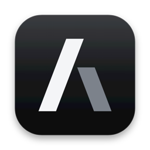
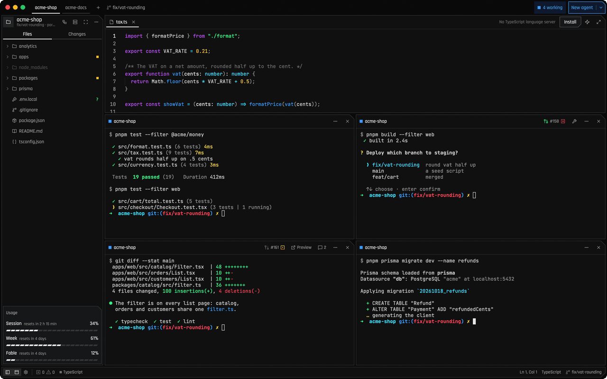
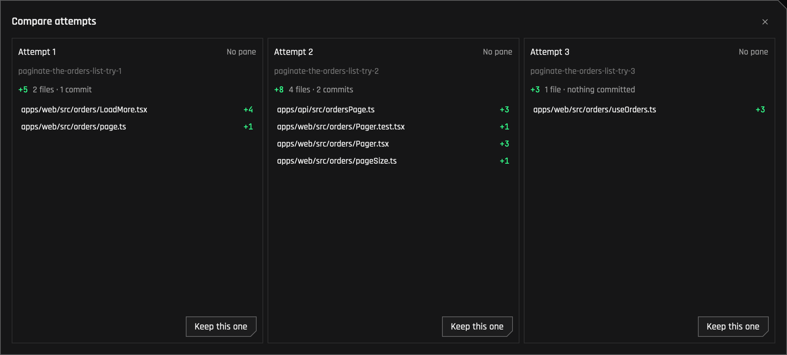

# Akyba

**Run many coding agents side by side, and see which one needs you.**

A native macOS workbench for [Claude Code](https://claude.com/claude-code) and
[Codex](https://developers.openai.com/codex): a grid of terminals, a light editor, a diff review,
and a clear signal when an agent needs you.

<a href="https://github.com/itsjonasarden/akyba/releases/latest/download/Akyba.dmg"><b>Download for macOS</b></a>
·
<a href="docs/features.md">Everything it does</a>
·
<a href="docs/shortcuts.md">Shortcuts</a>
·
<a href="docs/faq.md">FAQ</a>

<picture>
  <source media="(prefers-reduced-motion: reduce)" srcset="docs/images/akyba-window.png" />
  
</picture>

## Why

One agent is a terminal. Five are a juggling act: which one finished, which one waits for a
permission, which one broke the build. Akyba puts them on one screen, tells you where to look, and
keeps the files and diffs they touch one click away. It isn't an IDE; it's where the agents live.

## What you get

- **Who needs you.** A pane rings orange when its agent waits for you and green when it's done. The
  title bar counts them, and you can answer a permission without going to the pane.
- **Claude Code and Codex.** Akyba finds which you have; with both, pick one per agent, or give the
  same task to both and compare (Best of N). Each resumes after a restart, as it was.
- **Worktrees that just work.** New agent (⌘⇧N) makes a worktree on its own branch, installs what it
  needs and starts the agent. Finished worktrees go with one click.
- **Review without leaving.** Every change with its diff, comments that go straight to the agent,
  one change staged or reverted at a time, a turn undone.
- **Pull requests in view.** Each pane shows its pull request, checks and open review threads, and
  hands failures back to its agent.
- **A light editor.** Files, search, language servers and the project's own formatter.
- **Your plans' limits**, Claude's and Codex's, at the foot of the sidebar.
- **Routines and search.** Agents on a schedule, and every past session found by what you asked.
- **Two looks.** Cyberdeck, square panels with cut corners and neon signals on near-black, and
  Saturn, glass between rounded cards. Each in light and dark.

|  |  |
| :--------------------------------------------------------------------------------------------------------------: | :----------------------------------------------------------: |
|                                               **Search sessions**                                                |                         **History**                          |

[Everything Akyba does →](docs/features.md)

## Install

[Download Akyba](https://github.com/itsjonasarden/akyba/releases/latest/download/Akyba.dmg),
open the disk image and drag Akyba to Applications. It runs on macOS 13 or newer, on Apple Silicon
and Intel, with [Claude Code](https://claude.com/claude-code),
[Codex](https://developers.openai.com/codex) or both.

> [!NOTE]
> Akyba isn't notarised by Apple (it has no Apple Developer ID), so the first time you open it,
> click **Done**, then **Open Anyway** in System Settings → Privacy & Security. Only once.

Akyba updates itself: once a day it checks for a new release and offers it. To build it from the
code, see [Develop](docs/develop.md).

**Coming from Saturn?** Akyba was called Saturn until 0.2.0. Install Akyba and open it: your repos,
windows, sessions, routines and settings come over by themselves, and Claude Code's status line
follows. Then delete Saturn from Applications.

## The shortcuts that matter

| Keys     | Does                                  |
| -------- | ------------------------------------- |
| ⌘⇧N      | New agent, in a worktree of its own   |
| ⌘⇧A      | Jump to the next agent that needs you |
| ⌘D / ⌘⇧D | Split right / down                    |
| ⌘⇧↩      | Maximise the focused pane             |
| ⌘P       | Go to a file                          |
| ⌘⇧P      | Every command, by name                |

[All shortcuts →](docs/shortcuts.md)

## More

- [Everything Akyba does](docs/features.md)
- [Claude Code and Codex](docs/agents.md): how Akyba works with each, and what differs
- [Worktree recipe](docs/worktree-recipe.md): set up, run and check a worktree
- [Settings](docs/settings.md) · [Shortcuts](docs/shortcuts.md) · [FAQ](docs/faq.md)
- [Develop](docs/develop.md): build it, change it, [the rules](AGENTS.md)

## Licence

[MIT](LICENSE). Akyba bundles [Urbanist](https://github.com/coreyhu/Urbanist),
[Rajdhani](https://github.com/itfoundry/rajdhani) and [JetBrains Mono](https://www.jetbrains.com/lp/mono/) (SIL Open Font Licence), a few
[Lucide](https://lucide.dev) icons (ISC), and [Sparkle](https://sparkle-project.org) (MIT) for updates.
