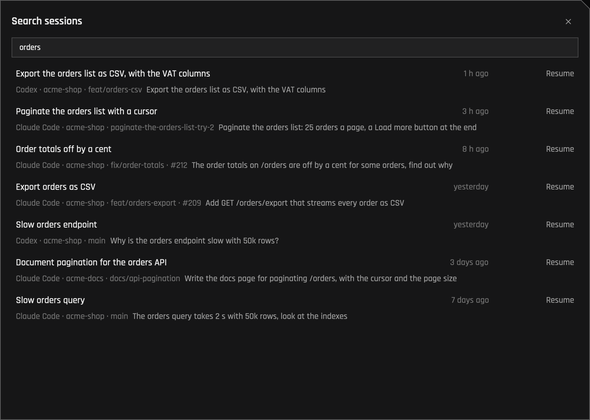
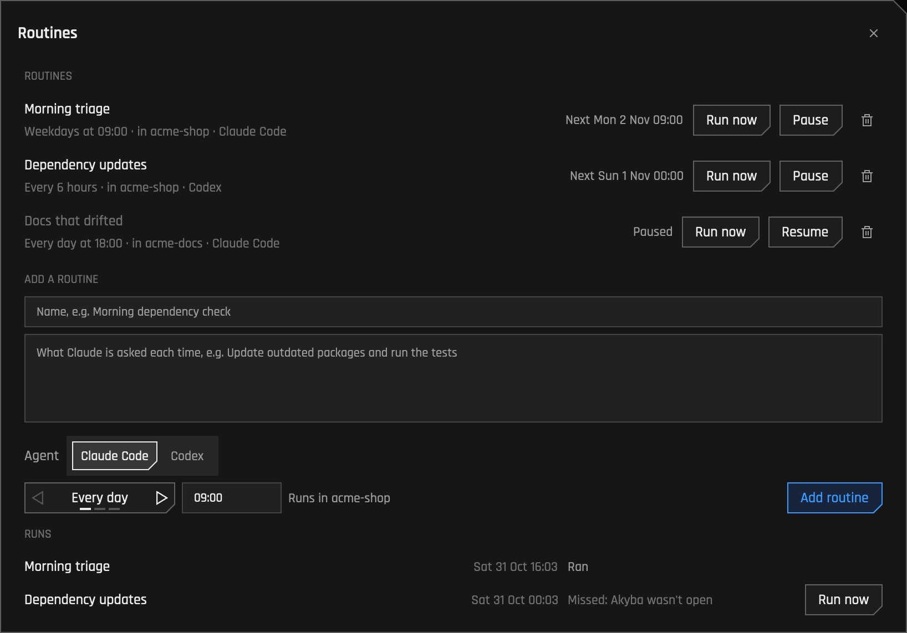
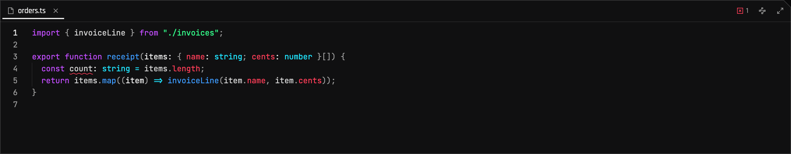
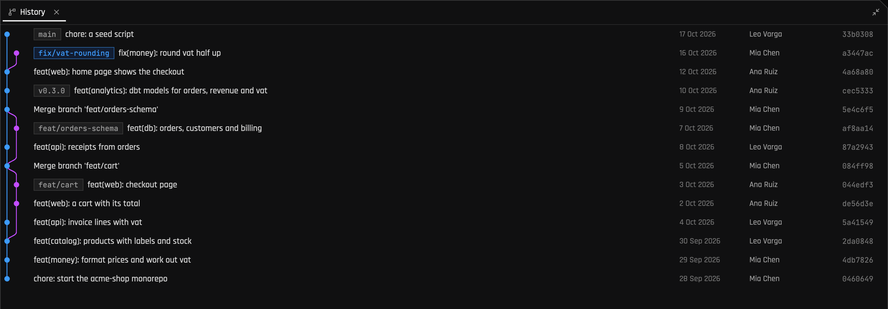
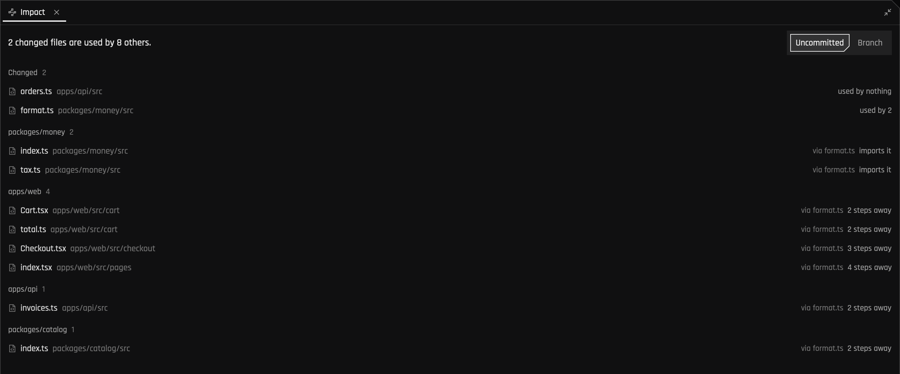
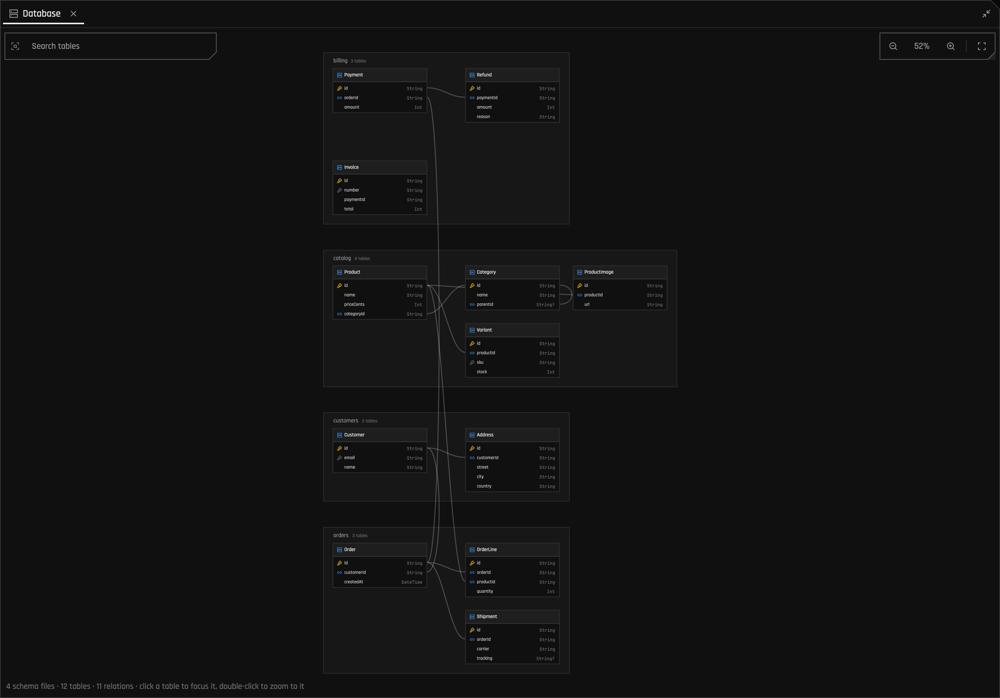
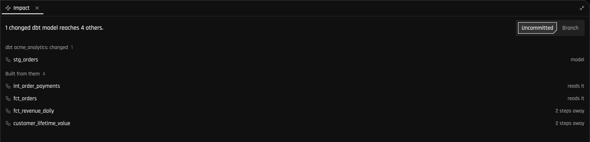

# Everything Akyba does

The [README](../README.md) has the short version. Here is all of it, by where you meet it.
Every feature has a button: the arrow beside **New agent** holds the other ways to start agents,
each pane's **⋯** what applies to it, the repo's **⋯** in the sidebar its worktrees and history, and
the menu bar lists them all. ⌘⇧P finds any of them by name.

## Agents

Akyba runs [Claude Code](https://claude.com/claude-code) and
[Codex](https://developers.openai.com/codex), side by side if you have both; see
[Claude Code and Codex](agents.md) for how it works with each.

Each pane shows whether its agent is working, waiting for you, done or failed.

- A pane that needs you rings **orange**, one that's done rings **green**, until you type or click
  in it. The blue ring marks the pane your keyboard is in, and only while it's there.
- The title bar counts them, and ⌘⇧A jumps to the next one that needs you. Click a count for what
  each waits for: a permission with the command or file it's for, a question, a finished turn with
  the start of its last words, a failure. Allow or deny a permission right there (Akyba presses the
  agent's own key in the pane), or go to the pane.
- **New agent** (⌘⇧N): press Return to start your agent right away, in a new pane with no task
  (Open a terminal, under the arrow beside New agent, opens a plain one). Or name the work (`fix-login`) and Akyba makes a worktree for it on a branch of
  that name, sets it up with the [worktree recipe](worktree-recipe.md), and starts your agent there.
  With both agents on your Mac, a Claude Code | Codex switch picks which, and remembers it.
- **Send to several agents** (the arrow beside New agent): one message, typed into every pane you
  pick. Panes with an agent are picked to begin with; a pane with only a shell starts your agent with
  it, and a busy one (a server, a build) is left alone.
- **Best of N** (the arrow beside New agent): one task given to two to four agents at once, each in a
  worktree of its own (branches `<task>-try-1`, `-try-2`…), each Claude Code or Codex as you choose:
  the two can take on the same task. **Compare attempts** (an attempt's pane shows Attempt 2, say:
  click it) lays them side by side: who made each, the files each changed with their lines, its
  commits, and whether its agent is still at it. Keep one, and the others' panes close and their
  worktrees are archived (Worktrees can restore them).
- **Search sessions** (the arrow beside New agent): every Claude Code and Codex session on this Mac,
  newest first, found by what you asked in it, its title, its folder or its branch. Pick one to
  resume it, with its own agent, in a new pane in its folder, or to go to the pane it's open in.
- **Routines** (the arrow beside New agent): agents on a schedule, every day, on weekdays or every
  few hours. While Akyba is open it starts each one on time in a pane named after it, with its
  prompt, in its folder, with its agent. Every run is listed; one whose time passed while Akyba was
  closed shows as missed, with Run now, and one that ran can be resumed. Kept in `routines.json`
  beside the settings.
- **Agent teams** (Claude Code's): a pane whose session leads a team shows a Team chip: how many are
  in it, how far its tasks are, and unread messages. It opens the members, the shared task list with
  who has each task, and the messages they've sent each other.
- **Work across repos**: with more than one repo in the window, New agent's "Also in" gives the work
  a worktree in each picked repo, on the same branch, and the agent reaches them all (`--add-dir`,
  which both agents take). A pane in such a worktree shows a chip for each other repo's.
- macOS notifies you while Akyba is in the background, and a small Akyba in the menu bar shows how
  many are waiting.
- **Your plans' limits** at the foot of the sidebar, Claude's and Codex's, each with when it resets,
  asked of each agent; offline, they aren't shown. With Akyba's status line on, Claude's come from
  what its sessions are already given, so Akyba asks Anthropic for them far less often.
  At 80% and 95% of a limit, a notification says so. With Akyba's status line on (Settings, off to
  begin with), each Claude Code agent shows under its prompt roughly how much of the 5-hour limit it
  used (`session 40% (≈2% here)`).
- Akyba opens where you left off, the windows you had open when it quit, however it's started (the
  Dock, an update's relaunch), and resumes the sessions that were running, each in its pane with its
  own agent (`claude --resume …`, `codex -p akyba resume …`), so every agent is back as you left it.
  Each agent can start with your own alias instead (`cdsk`, in Settings → Agents). A pane shows its
  work's chips (ticket, pull request, checks) only while an agent runs in it.

|  |  |
| :---------------------------------------------------------------------------------------------------------: | :------------------------------------------------------------------------------------: |
|                                             **Search sessions**                                             |                                      **Routines**                                      |

## Terminals

- Every terminal is a pane of its own, with its session's name at the top; there are no tabs
  inside panes. Each pane's ⋯ opens a new terminal or agent and holds what applies to the pane, with
  ✕ beside it to close it; ⌘D and ⌘⇧D split right and down. Drag a
  pane by its name onto another's edge to move it there, or onto its middle to swap the two.
  Maximise a pane over everything from its ⋯, or ⌘⇧↩. Panes share the space
  evenly whenever one opens or closes; drag a divider to change that, or double-click it to even
  out its two panes. ⌘⌃= evens out them all.
- A real terminal underneath (alacritty's engine), so TUIs, colours and the mouse work as they should.
- Drop a file, a screenshot say, on a terminal to type its path, so the agent attaches it; the
  terminal it will land in lights up while you drag. Pasting works the same: copied files (from
  Finder) and copied images paste as paths.
- ⌘-click a link to open it, a pull request linked as `#123` too.
- Each pane shows the servers its agent runs, named after their app and port (`web :5173`); click one
  to open it. The repo's Docker Compose services (`postgres :5432`) sit in the bar at the bottom.
- Several repos in one window, as tabs in the title bar (the + after them, or ⌘O, adds one). Each
  repo has its own grid and open files, as a browser tab has its own page: click a repo and its terminals and files show,
  while the others' keep running out of sight. A repo whose agent waits for you shows a dot on its
  tab, and ⌘⇧A goes to it. After the tabs, the branch the repo showing is on (and the worktree,
  when the sidebar follows a pane into one).
- Turn on Follow (the target beside the repo's name), and the sidebar follows the focused pane into
  its worktree.

## Worktrees

- **Worktrees** (the repo's ⋯): every worktree of the repo with its branch, last commit, pull
  request and whether its work is merged (squash merges too). The finished ones, with nothing
  uncommitted, no open pull request and nothing running in them, go with one click, at once: the
  folder moves aside and its files are deleted in the background. One you're not working on now can
  be archived: its branch and uncommitted work are kept, the folder goes, and Restore brings it back
  where it was and sets it up again.
- Worktrees share the main checkout's `.env` files: each one's is a link to main's, so a value added
  in any worktree is in all of them. `CLAUDE.local.md` and `.claude/settings.local.json` are shared
  the same way. A worktree's own, different file is left alone.
- Each checkout gets its own block of ten ports (`AKYBA_PORT`), and its own setup, run commands and
  checks from the [worktree recipe](worktree-recipe.md).

## Files and editor

- ⌘P finds any file by a few letters of its name or path; ⌘⇧P finds any command.
- A file tree with an icon for each kind of file and git badges; what git ignores is shown faint.
  Right-click to make a file or folder there, rename one, or move it to the Trash (New file and
  New folder are in the repo's ⋯ too); drag a file or folder onto another folder to move it.
- Syntax highlighting for about 60 languages, saved with your project's own formatter (Prettier,
  Biome, oxfmt or rustfmt).
- Files an agent changes reload by themselves; if you have unsaved edits, Akyba asks first.
- Language servers for TypeScript and JavaScript, Rust, Python and Go: completions, hover, go to
  definition (⌘-click), quick fixes, Find references and Rename (⌘.), and errors as you type. For
  TypeScript, Akyba installs one with a click when there's none.

## Review

- **Changes**: every changed file, for your uncommitted work or the whole branch, with a diff for
  each and checkboxes to stage them.
- **Comments for the agent**: the + beside a line in the diff (or a selection of lines) takes a
  comment, as in a pull request review. "Send to the agent" gives them all to the agent working there
  in one message, each with its file, lines and code; with no agent there, a new pane starts one.
- **One change at a time**: click a line in the review to pick its change, then stage just that one,
  or revert it, leaving the file's other changes as they are. A revert can be undone.
- **Compare with anything**: "Compare with a branch or commit" (the repo's ⋯, or the button under
  Changes) reviews everything that differs from a branch, tag or commit, uncommitted work too.
- **Undo a turn**: Akyba saves a worktree's files when its agent starts a turn and when it ends it
  (in git, under its own `refs/akyba/`, touching no branch and running no hook). The pane's ↶ puts
  back exactly the files that turn changed, however it changed them; ↷ redoes it.
- **Pictures of the app** (the pane's ⋯): the pages of a pane's running server, drawn at a desktop's
  size and a phone's by a Chromium browser already on your Mac. Each set is kept with its branch and
  time, so two lie side by side. "Preview the app" shows a pane's running page in the editor panel,
  drawn again every few seconds.
- **What the agent is told** (the pane's ⋯): everything the pane's agent is given, found as it finds
  it. For Claude Code: instruction files (`CLAUDE.md`, `CLAUDE.local.md`, and `AGENTS.md` where
  there's no `CLAUDE.md`), rules, skills, commands, subagents, hooks and MCP servers. For Codex:
  `AGENTS.override.md` or `AGENTS.md` in each folder, yours, and skills in `.agents/skills`. Long
  instruction files get a word, and anything said in more than one file comes first.
- **Teach the repo** (the pane's ⋯): the pane's recent prompts, corrections ("no, don't…",
  "always…") first; pick one, say it as a lesson, and add it under `## Lessons` in `AGENTS.md` (which
  both agents read) or `CLAUDE.md`, where it shows in Changes to review.
- **Overlaps**: when two panes' worktrees of one repo change the same files, both panes say so.
- **What was asked** (Claude Code): each file in the review says what you asked that changed it,
  read from the session's transcript on your Mac.
- **History**: every branch as a graph, with tags, authors and dates; click a commit for its diff.
- **Impact**: every file that depends on what changed, nearest first, following imports in
  JavaScript and TypeScript (with `tsconfig` aliases and a monorepo's packages), Rust and Python. In a
  dbt project it follows the lineage down to the exposures (dashboards, apps) that read it.
- **Pull requests**: each pane shows the one it works on, with its state, from the `gh` CLI. Its
  checks show beside it, and when they fail, the wrench hands them to the pane's agent. Open review
  threads count beside it (💬 2): click to hand them to the agent too. When the repo deploys pull
  requests, ↗ Preview opens this one's. "Edit the pull request's description" (the pane's ⋯) edits it
  against the repo's template, or hands the writing to the agent.
- **Status bar**: first the toggles for the sidebar, the editor and the tickets, and Settings; then
  errors and warnings, the cursor, the language, and the branch with how many commits wait to be
  pushed and pulled.

|  |  |
| :-----------------------------------------------------: | :--------------------------------------------------------------: |
|                       **History**                       |                            **Impact**                            |

## Data

- **Database**: a Prisma schema or SQL migrations drawn as a diagram, every table with its columns
  and keys and a line for each foreign key. Pinch to zoom, search, click a table to see what it's
  connected to.
- **dbt lineage**: sources and seeds on the left, then each model past what it reads. Click a model
  to light up what's upstream and downstream, double-click to open its SQL. dbt itself isn't needed.

## Tickets (optional)

Connect a ClickUp token, and New agent (⌘⇧N) also searches the tickets assigned to you; ⌘⌥B shows
them as a panel on the right, with filters for status, priority, due date, space, list and tag. Pick
one, and Akyba opens a pane (in its own worktree if you like) and starts your agent on it. Without a
tracker, New agent starts work you name, and the rest doesn't show up.

## Looks

Two themes (Settings → Appearance). Cyberdeck, the default: square panels with cut corners on a
near-black ground, true greys, neon signals and sharp icons. Saturn: cards on a deep navy backdrop
(soft periwinkle in light), with rounded corners and glass. Each follows macOS's appearance, or you
pick light or dark. Terminals tell programs
which it is when they ask, so an agent's "Auto" theme matches, and switches with it.
